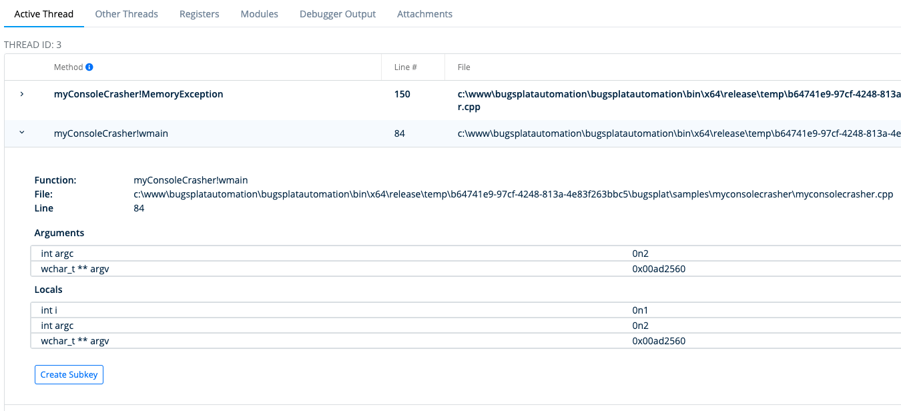

# Crash details 'Active Thread'

The **Method** column contains a list of methods in the stack trace of the thread that caused your program to crash. Depending on the [platform](../../integrations/integrations.md) you may see methods that don't match your source code. This is because platforms such as [Windows Native](../../integrations/desktop/cplusplus/), [.NET](../../integrations/desktop/bugsplat-for-dot-net.md), [Crashpad](../../integrations/desktop/crashpad/), [Breakpad](../../integrations/desktop/breakpad.md), [macOS](../../integrations/desktop/macos.md), [Unity](../../integrations/game-development/unity.md), and [Unreal](../../integrations/game-development/unreal-engine/) require you to upload [symbols](../../guides/working-with-symbol-files/) for each version you release in order to calculate the correct method names. For more information on how to upload symbols please see the documentation for your [platform](../../integrations/integrations.md).

Clicking the **>** (greater than symbol) in the left-most column will expand the **Row Details** view.

The **Row Details** view will display **Group Rules**, **Ignore Function**, and **Ignore File** buttons that will take you to the grouping rules screen where you can create a [Group](../../guides/grouping-crashes.md). Grouping at a different level of the call stack is useful in cases such as a crash that occurs in a 3rd party library, or when additional stack frames are added by a crash reporter.

Additionally, for [Windows Native](../../integrations/desktop/cplusplus/) crashes the **Row Details** view will show a table of [Local Variables and Function Arguments](https://blog.bugsplat.com/local-variables-function-arguments/).

When you land on the crash details page, BugSplat starts a debugging session in the background that will calculate additional information about the crash. This additional information includes the call stacks for the non-active threads, register values, loaded modules, and function argument and local variable values. You will see a loading indicator when this information isn't yet available.
