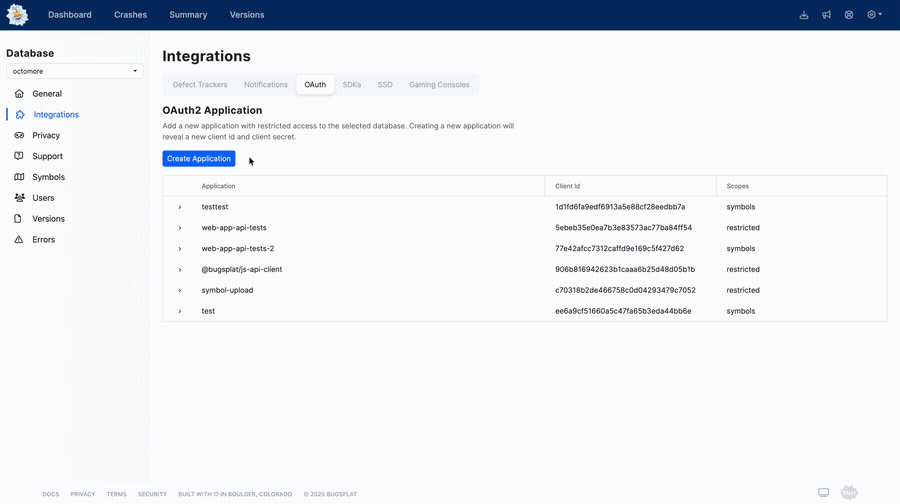

# OAuth2

BugSplat's API authenticates via OAuth 2.0. Username and password authentication is no longer supported. Currently, only the OAuth2 client credentials flow is supported. If you are interested in exploring other OAuth 2.0 authentication methods, please contact [support@bugsplat.com](mailto:support@bugsplat.com).

A reference client implementation can be found in our [@bugsplat/js-api-client](https://github.com/BugSplat-Git/bugsplat-js-api-client/blob/main/src/common/client/oauth-client-credentials-api-client/oauth-client-credentials-api-client.ts) repo.

### Client Credentials

To authenticate via OAuth2 client credentials, you will need to create a Client ID and Client Secret pair on the [OAuth Integrations](https://app.bugsplat.com/v2/database/integrations#oauth) page. When prompted, enter an application name and choose a desired scope.

BugSplat scopes are hierarchical (not composable), and the available choices are either **symbols** or **restricted**. The only operation allowed by the **symbols** scope is [symbol upload](../working-with-symbol-files/upload-symbols-with-symbol-upload.md). The **restricted** scope provides read-only access to the [Charting](api/charting.md), [Crash](api/crash.md), [Crashes](api/crashes.md), [Summary](api/crash-groups.md#summary), [Versions](api/versions.md), and [Key Crash](api/crash-groups.md#key-crash) APIs

<figure><figcaption><p>Adding a New Application</p></figcaption></figure>

Copy the Client ID and Client Secret to a secure location. Once you've dismissed the dialog, the Client Secret will not be displayed again.

Each Client ID and Client Secret pair belongs to one database. Access tokens issued for it can only read or upload to that database. If you work with several databases, create a client for each one, or create them in bulk with the [Manage Clients](oauth2.md#manage-clients) endpoints below.

#### Authorize

The Client ID and Client Secret are used in a POST to the server and will return `access_token` and a `token_type`. The [Authorize](oauth2.md#authorize-1) endpoint is described below.

#### Headers

Once an `access_token` and `token_type` have been acquired, they can be used in any of the API requests outlined in our [API docs](api/). To make an authenticated request to one of BugSplat's API endpoints, add a header with a key of `Authorization` and a value of `${token_type} ${access_token}`.

## Authorize

<mark style="color:green;">`POST`</mark> `https://app.bugsplat.com/oauth2/authorize`

Exchange a Client Id and Client Secret for a bearer token.

#### Request Body

| Name           | Type   | Description                                                                       |
| -------------- | ------ | --------------------------------------------------------------------------------- |
| scope          | string | Optional. Defaults to the scope the client was created with (**symbols** or **restricted**). |
| client\_secret | string | The Client Secret created above                                                   |
| client\_id     | string | The Client Id created above                                                       |
| grant\_type    | string | <p>OAuth2 grant type, in this case,</p><p><strong>client_credentials</strong></p> |

```bash
curl https://app.bugsplat.com/oauth2/authorize \
  -F grant_type=client_credentials \
  -F client_id="$BUGSPLAT_CLIENT_ID" \
  -F client_secret="$BUGSPLAT_CLIENT_SECRET"
```



```
{
  "token_type": "Bearer",
  "expires_in": 86400,
  "access_token": "eyJ0eXAiOiJKV1QiLCJhbGciOiJSUzI1NiJ9[...]"
}
```



## Manage Clients

These endpoints do the same work as the [OAuth Integrations](https://app.bugsplat.com/v2/database/integrations#oauth) page. Use them to list, create, and delete clients from a script, for example to create one client for each of your databases.


Managing clients requires a signed-in BugSplat user with admin (unrestricted) rights on the database. An OAuth2 access token can't create or delete clients. Sign in once with your email and password, then send the session cookie and the `xsrf-token` header with each request, as shown in the example at the end of this section. Single sign-on (SSO) accounts can't sign in this way. Use the OAuth Integrations page instead.


### List Clients

<mark style="color:blue;">`GET`</mark> `https://app.bugsplat.com/oauth2/register`

Returns the clients for a database. Client Secrets are never returned.

#### Query Parameters

| Name                                       | Type   | Description       |
| ------------------------------------------ | ------ | ----------------- |
| database<mark style="color:red;">\*</mark> | string | Name of the database |



```json
{
  "status": "success",
  "apps": [
    {
      "clientId": "3f2c9d0a5b7e41c8a6d2e9f01b3c4d5e",
      "name": "crash-summary-script",
      "database": "Fred",
      "redirectURI": null,
      "scope": "restricted",
      "dateAdded": "2026-10-29 14:02:11",
      "lastUsed": "2026-10-29 15:30:00"
    }
  ]
}
```



### Create Client

<mark style="color:green;">`POST`</mark> `https://app.bugsplat.com/oauth2/register`

Creates a client for a database and returns its Client ID and Client Secret. The Client Secret is returned only once. Store it before you make another request.

#### Request Body

| Name                                       | Type   | Description                                         |
| ------------------------------------------ | ------ | --------------------------------------------------- |
| database<mark style="color:red;">\*</mark> | string | Name of the database the client can access          |
| name<mark style="color:red;">\*</mark>     | string | A label for the client, 1 to 128 characters         |
| scope<mark style="color:red;">\*</mark>    | string | **restricted** or **symbols**                       |



```json
{
  "status": "success",
  "clientId": "3f2c9d0a5b7e41c8a6d2e9f01b3c4d5e",
  "clientSecret": "Jx8f[...]",
  "name": "crash-summary-script",
  "database": "Fred",
  "scope": "restricted"
}
```



### Delete Client

<mark style="color:red;">`DELETE`</mark> `https://app.bugsplat.com/oauth2/register`

Deletes a client. Access tokens already issued to it stop working.

#### Query Parameters

| Name                                       | Type   | Description                            |
| ------------------------------------------ | ------ | -------------------------------------- |
| database<mark style="color:red;">\*</mark> | string | Name of the database the client belongs to |
| clientId<mark style="color:red;">\*</mark> | string | Client ID to delete                    |



```json
{
  "status": "success",
  "clientId": "3f2c9d0a5b7e41c8a6d2e9f01b3c4d5e",
  "database": "Fred"
}
```



### Example: create a client for each database

```bash
BUGSPLAT_EMAIL="you@example.com"

# Prompt for the password without showing it or saving it in your shell history.
printf 'Password: '; read -rs BUGSPLAT_PASSWORD; echo

# Sign in once. The session cookie is saved to cookies.txt.
curl -s -c cookies.txt https://app.bugsplat.com/api/authenticatev3 \
  --data-urlencode "email=$BUGSPLAT_EMAIL" \
  --data-urlencode "password=$BUGSPLAT_PASSWORD" > /dev/null
unset BUGSPLAT_PASSWORD

XSRF=$(awk '$6 == "xsrf-token" { print $7 }' cookies.txt)

# Create a restricted client for each database where you have admin rights.
curl -s -b cookies.txt https://app.bugsplat.com/api/databases |
  jq -r '.[] | select(.rights != 0) | .dbName' |
  while read -r db; do
    curl -s -b cookies.txt -H "xsrf-token: $XSRF" \
      https://app.bugsplat.com/oauth2/register \
      --data-urlencode "database=$db" \
      -d name=crash-summary-script \
      -d scope=restricted
    echo
  done > clients.json
```

`clients.json` then holds one Client ID and Client Secret per database. Move them to your secret store and delete the file.
