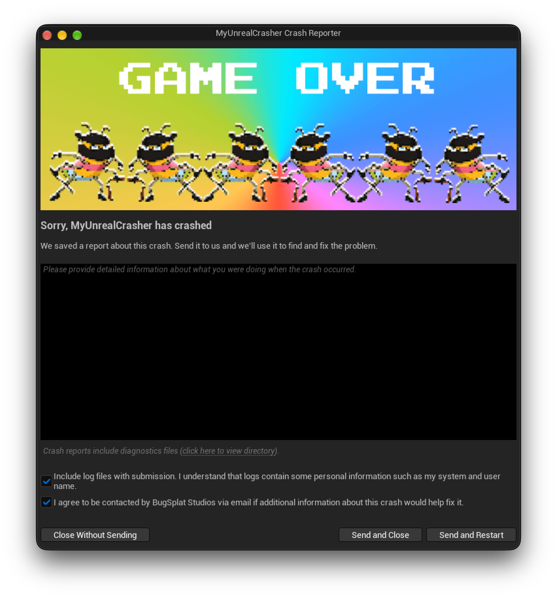

# Customizing the Crash Report Client


We tested this guide with Unreal Engine 5.8.4. File names and code are the same in nearby 5.x releases, but line numbers shift between versions.


## Overview

Crash Report Client is the Unreal Engine program that appears when a game or the editor crashes. It shows a dialog where the player can describe what they were doing, then uploads the crash report. Once you set `DataRouterUrl` (see [Unreal Engine](../unreal-engine.md#configuring-crash-report-client)), those reports go to BugSplat.

Out of the box the dialog still reads like an Epic Games tool. It says "An Unreal process has crashed", thanks the player for "helping improve the Unreal Engine", and links to Epic's bug submission form. Players who see an Epic dialog in your game are less likely to fill it in. A dialog with your game's name, your studio's logo and your own wording gets better reports at one of the most frustrating moments of play.

There are two levels of customization:

* **Configuration only.** Change the message, the company name and which checkboxes appear by editing your project's `DefaultEngine.ini`. No engine rebuild needed.
* **Engine source.** Add a banner image, resize the window and hide the call stack by changing the Crash Report Client source and rebuilding it.

## Customize the dialog with configuration

Add the following to your project's `Config/DefaultEngine.ini`, in the same file as your `DataRouterUrl` setting:

```ini
[CrashContextProperties]
CrashReportClientRichText=INVTEXT("We saved a report about this crash. Send it to us and we'll use it to find and fix the problem.")

[CrashReportClient]
CompanyName=BugSplat Studios
bHideLogFilesOption=false
bHideAllowToBeContactedOption=false
```

* `CrashReportClientRichText` replaces Epic's default message, including the link to Epic's bug submission form. The game reads this value when it starts, so it applies to packaged builds.
* `CompanyName` sets the name in the contact checkbox: "I agree to be contacted by BugSplat Studios via email if additional information about this crash would help fix it." Without it, the checkbox doesn't name a company.
* `bHideLogFilesOption=true` hides the "Include log files with submission" checkbox.
* `bHideAllowToBeContactedOption=true` hides the contact checkbox.

These options work in packaged games because the game copies its `[CrashReportClient]` section, `DataRouterUrl` included, into a `CrashReportClient.ini` file that it hands to Crash Report Client at crash time.

## Customize the dialog in engine source

The banner image, window size and call stack panel can only be changed in the Crash Report Client source. Unreal Engine is source-available, and the changes below are small. Most of the effort is getting the engine to build.

After completing this section, and the configuration changes above, your Crash Report Client dialog will look like this:

<figure><figcaption></figcaption></figure>

### Prerequisites

To download the Unreal Engine source, connect your GitHub account to your Epic Games account. Epic then invites you to the Epic Games organization on GitHub, where you can access the `EpicGames/UnrealEngine` repository. See [Downloading Source Code](https://dev.epicgames.com/documentation/en-us/unreal-engine/downloading-source-code-in-unreal-engine) for the steps.

Clone the repository and check out the release your game uses:

```batch
git clone --branch 5.8.4-release https://github.com/EpicGames/UnrealEngine
```

Then follow the "Getting up and running" section of the repository's `README.md`. On Windows that means installing Visual Studio 2022 with the components listed in [Setting Up Visual Studio](https://dev.epicgames.com/documentation/en-us/unreal-engine/setting-up-visual-studio-development-environment-for-cplusplus-projects-in-unreal-engine), running `Setup.bat` and `GenerateProjectFiles.bat`, and building `UE5.sln`. Make sure you can start the editor from Visual Studio before you continue.

### Customizing the Engine

Crash Report Client is built from two targets in `UE5.sln`, both under Programs:

* `CrashReportClient` shows the dialog for packaged games.
* `CrashReportClientEditor` shows the dialog when the editor crashes.

Both targets compile the same source files in `Engine/Source/Programs/CrashReportClient/Private`. Once the engine has been built, you only need to rebuild these two targets to see your changes, which is much faster than rebuilding the engine. This guide changes three files: `CrashReportClientStyle.cpp`, `SCrashReportClient.cpp` and `CrashReportClientApp.cpp`.

#### Add a banner image

The dialog is built with Unreal Engine's [Slate UI framework](https://dev.epicgames.com/documentation/en-us/unreal-engine/slate-user-interface-programming-framework-for-unreal-engine), and its styles are defined in `CrashReportClientStyle.cpp`. Crash Report Client loads style images from `Engine/Content/Slate`. Create a directory named `Engine/Content/Slate/CrashReportClient` and save your banner there as `Brand.png`. The dialog is 740 points wide, so a banner 720 points wide fits with a small margin.

Next, register the image as a brush in the style set. In `CrashReportClientStyle.cpp`, inside `FCrashReportClientStyle::Create`, add the following line just before `return StyleRef;` ([line 130](https://github.com/EpicGames/UnrealEngine/blob/5.8.4-release/Engine/Source/Programs/CrashReportClient/Private/CrashReportClientStyle.cpp#L130) in 5.8.4):

```cpp
Style.Set("Brand", new IMAGE_BRUSH("CrashReportClient/Brand", FVector2D(720, 248)));
```

This line defines an image brush for `Engine/Content/Slate/CrashReportClient/Brand.png`, drawn at 720 by 248 points and stored in the style set under the key `Brand`. The image file can be larger than the brush. Save it at twice the brush size or more (1440 by 496 pixels here) so that it stays sharp on high-DPI displays. For pixel art, scale it up with nearest-neighbor resampling so the edges stay crisp. In our experience, a brush declared directly in the dialog code doesn't load at runtime.

Now add the image to the dialog. In `SCrashReportClient.cpp`, find `SCrashReportClient::ConstructDetailedDialog` and add the following slot just under the comment `// Stuff anchored to the top` ([line 157](https://github.com/EpicGames/UnrealEngine/blob/5.8.4-release/Engine/Source/Programs/CrashReportClient/Private/SCrashReportClient.cpp#L157) in 5.8.4):

```cpp
+SVerticalBox::Slot()
.AutoHeight()
.Padding(FMargin(4, 10))
[
    SNew(SImage)
    .Image(FCrashReportClientStyle::Get().GetBrush("Brand"))
]
```

The slot is added to the dialog's top-level `SVerticalBox`, sizes itself to its content and has a small amount of padding. Inside it, an `SImage` widget displays the `Brand` brush.

#### Test your changes

In Visual Studio, keep the Development Editor configuration selected, then right-click `CrashReportClientEditor` and select Build. Do the same for `CrashReportClient` so that packaged games get the change too.

On Windows, the editor looks for `CrashReportClientEditor.exe` (the Shipping build) first, then `CrashReportClientEditor-Win64-Development.exe`. If you've built the Shipping configuration at any point, rebuild that one too, or the editor keeps showing the old dialog.

To show the dialog, start the editor from Visual Studio and open any project. Our sample project [my-unreal-crasher](https://github.com/BugSplat-Git/my-unreal-crasher) works well. Click Play, press the backtick key (`` ` ``) to open the console, and enter `debug crash`. The editor crashes and Crash Report Client opens with your banner. To skip the clicking, start the editor with `-ExecCmds="debug crash"` and it crashes as soon as the project loads.

If Send and Close and Send and Restart are grayed out, Crash Report Client has nowhere to send the report. Set `DataRouterUrl` as described in [Unreal Engine](../unreal-engine.md#configuring-crash-report-client).


**macOS:** the editor only launches `CrashReportClientEditor.app`, which is the Shipping build, so build that configuration:

```bash
Engine/Build/BatchFiles/Mac/Build.sh CrashReportClientEditor Mac Shipping
```

If the build fails with `The selected platform is no longer supported by libc++`, your Xcode no longer supports the macOS 10.9 deployment target that Crash Report Client asks for. Set `bEnableOSX109Support = false` in `Engine/Source/Programs/CrashReportClient/CrashReportClient.Target.cs` and build again.


#### Resize the window

The banner takes up space that the text boxes used to have, so they're squeezed. To make the dialog taller, change the default window size in `CrashReportClientApp.cpp` ([line 55](https://github.com/EpicGames/UnrealEngine/blob/5.8.4-release/Engine/Source/Programs/CrashReportClient/Private/CrashReportClientApp.cpp#L55) in 5.8.4). The default is 740 by 560. With the 248-point banner and the call stack removed (see [Hide the call stack](#hide-the-call-stack)), 770 points leaves a comfortable description box:

```cpp
/** Default main window size */
const FVector2D InitialWindowDimensions(740, 770);
```

If your game attaches a screenshot to its crash reports, the dialog uses `InitialWindowDimensionsWithScreenshot` (740 by 1000) a few lines below. Increase that value as well.

#### Change the remaining Epic text

The configuration options above replace the main message and the contact checkbox. The heading above the message is set in code. By default it reads "An Unreal process has crashed: UE-MyUnrealCrasher". The name comes from the crash's `GameName` property, which Unreal Engine prefixes with `UE-`.

To show a friendlier heading, such as "Sorry, MyUnrealCrasher has crashed", make two changes in `SCrashReportClient::ConstructDetailedDialog`. First, replace the `CrashedAppText` definition ([lines 85 to 87](https://github.com/EpicGames/UnrealEngine/blob/5.8.4-release/Engine/Source/Programs/CrashReportClient/Private/SCrashReportClient.cpp#L85-L87) in 5.8.4) with a version that removes the prefix and puts the name in the sentence:

```cpp
FString DisplayName = CrashedAppName;
DisplayName.RemoveFromStart(TEXT("UE-"));
const FText CrashedAppText = CrashedAppName.IsEmpty() ?
	LOCTEXT( "CrashedAppNotFound", "An unknown process has crashed" ) :
	FText::Format( LOCTEXT( "CrashedAppUnreal", "Sorry, {0} has crashed" ), FText::FromString( DisplayName ) );
```

Second, the heading shows the name a second time in its own text block. Delete the second `+SHorizontalBox::Slot()` in the heading, the one that displays `FText::FromString(CrashedAppName)` ([lines 171 to 177](https://github.com/EpicGames/UnrealEngine/blob/5.8.4-release/Engine/Source/Programs/CrashReportClient/Private/SCrashReportClient.cpp#L171-L177) in 5.8.4).

If you can't change your project's configuration, you can also edit the default message in code. The default message is the `CrashDetailed` string in `SCrashReportClient::Construct` ([line 56](https://github.com/EpicGames/UnrealEngine/blob/5.8.4-release/Engine/Source/Programs/CrashReportClient/Private/SCrashReportClient.cpp#L56) in 5.8.4). `CrashReportClientRichText` overrides this string when it's set.

#### Hide the call stack

The lower half of the dialog shows the crash's call stack. In a released game the call stack usually has no function names, and it confuses players more than it helps them. To remove it, find the `SSplitter` in `ConstructDetailedDialog` ([lines 192 to 281](https://github.com/EpicGames/UnrealEngine/blob/5.8.4-release/Engine/Source/Programs/CrashReportClient/Private/SCrashReportClient.cpp#L192-L281) in 5.8.4). The splitter's first slot holds the description box, and its second slot holds the call stack. Replace the whole `+SVerticalBox::Slot()` that contains the splitter with these two slots. The description box takes the remaining space, and a link to the crash's files sits below it. Epic's text for that link ends with "and the following summary information:", which no longer makes sense once the summary is gone, so the second slot uses its own wording:

```cpp
+SVerticalBox::Slot()
.Padding(FMargin(4, 10, 4, 4))
[
	SNew(SOverlay)
	+ SOverlay::Slot()
	[
		SAssignNew(CrashDetailsInformation, SMultiLineEditableTextBox)
		.Style(&FCrashReportClientStyle::Get().GetWidgetStyle<FEditableTextBoxStyle>("NormalEditableTextBox"))
		.OnTextCommitted(CrashReportClient.ToSharedRef(), &FCrashReportClient::UserCommentChanged)
		.OnTextChanged(this, &SCrashReportClient::OnUserCommentTextChanged)
		.Font(FCoreStyle::GetDefaultFontStyle("Regular", 9))
		.AutoWrapText(true)
		.BackgroundColor(FSlateColor(FLinearColor::Black))
		.ForegroundColor(FSlateColor(FLinearColor::White * 0.8f))
	]

	// HintText is not implemented in SMultiLineEditableTextBox, so this is a workaround.
	+ SOverlay::Slot()
	[
		SNew(STextBlock)
		.Margin(FMargin(4, 2, 0, 0))
		.Font(FCoreStyle::GetDefaultFontStyle("Italic", 9))
		.ColorAndOpacity(FSlateColor(FLinearColor::White * 0.5f))
		.Text(LOCTEXT("CrashProvide", "Please provide detailed information about what you were doing when the crash occurred."))
		.Visibility(this, &SCrashReportClient::IsHintTextVisible)
	]
]

+SVerticalBox::Slot()
.AutoHeight()
.Padding(FMargin(4, 4))
[
	SNew(SRichTextBlock)
	.Margin(FMargin(4, 2, 0, 8))
	.TextStyle(&FCrashReportClientStyle::Get().GetWidgetStyle<FTextBlockStyle>("CrashReportDataStyle"))
	.Text(FText::Format(LOCTEXT("CrashReportFiles", "Crash reports include diagnostics files (<a id=\"browser\" href=\"{0}\" style=\"Richtext.Hyperlink\">click here to view directory</>)."), FText::FromString(CrashReportClient->GetCrashDirectory())))
	.AutoWrapText(true)
	.DecoratorStyleSet(&FCrashReportClientStyle::Get())
	+ SRichTextBlock::HyperlinkDecorator(TEXT("browser"), FSlateHyperlinkRun::FOnClick::CreateStatic(&OnViewCrashDirectory))
]
```

While you test on your own machine, the call stack is useful, especially for editor crashes where Unreal Engine can find symbols and show function names. To keep it in your local builds and hide it in the engine you distribute, wrap both versions in a compiler conditional:

```cpp
#if UE_BUILD_SHIPPING
	// The two slots above: the description box and the link to the crash's files
#else
	// Epic's original slot containing the SSplitter and the call stack
#endif
```

`UE_BUILD_SHIPPING` refers to the configuration Crash Report Client was compiled in. Your game's build configuration has no effect on it. Building from Visual Studio in the Development Editor configuration produces a Development build, so you see the call stack. An installed build (see [Distribution](#distribution)) compiles both Crash Report Client targets in the Shipping configuration, so everyone who uses that engine sees the shorter dialog, for game crashes and editor crashes alike. On macOS the editor always runs the Shipping build, so editor crashes show the shorter dialog there too.

Your players now see your studio's name, logo and wording when your game crashes. Happy splattin'.

## Distribution

If people on your team work on the game without building your version of the engine themselves, build an installed engine for them. An installed build is a precompiled copy of the engine, like the one the Epic Games Launcher installs. Several installed builds can live side by side on one machine, and each project picks the one it uses.

The following steps create an installed build on Windows:

1. Clone the Unreal Engine source code:

   ```batch
   git clone --branch 5.8.4-release https://github.com/EpicGames/UnrealEngine
   ```
2. Run `Setup.bat`
3. Run `GenerateProjectFiles.bat`
4. Open `UE5.sln` with Visual Studio 2022
5. Make the code changes from the [Customizing the Engine](#customizing-the-engine) section
6. Verify that you can build and run the editor and that it contains your changes
7. In the `UnrealEngine` root directory, run the Unreal Automation Tool to build an installed engine for Win64:

   ```batch
   Engine\Build\BatchFiles\RunUAT.bat BuildGraph -script=Engine/Build/InstalledEngineBuild.xml -target="Make Installed Build Win64" -set:HostPlatformOnly=true
   ```

   `HostPlatformOnly=true` builds for Windows only, so you don't need the SDKs for Android, Linux or other platforms. Add the `-set:` option for each extra platform your game targets, for example `-set:WithAndroid=true`. To make BugSplat the default destination for crash reports from games built with this engine, also add `-set:CrashReporterURL=https://{database}.bugsplat.com/post/ue4/{appName}/{appVersion}` and `-set:CrashReporterCompanyName="BugSplat Studios"`, replacing the values in braces with your own. A `DataRouterUrl` or `CompanyName` in a project's `DefaultEngine.ini` still overrides these defaults.
8. The installed engine is saved to `LocalBuilds\Engine\Windows`. Copy that folder to each machine that needs it, and run `Engine\Binaries\Win64\UnrealEditor.exe` from inside it to create games with your customized engine.
9. To open existing projects with your customized engine, edit the `.uproject` file and change the `EngineAssociation` field. After the editor has been launched once on a machine, you can find the value by opening `regedit` and navigating to `HKEY_CURRENT_USER\Software\Epic Games\Unreal Engine\Builds`. Use the name of the entry whose value is the path to your installed engine folder.

For more options, see Epic's [Create an Installed Build](https://dev.epicgames.com/documentation/en-us/unreal-engine/create-an-installed-build-of-unreal-engine) guide.

Please send any comments or questions to [support@bugsplat.com](mailto:support@bugsplat.com).
