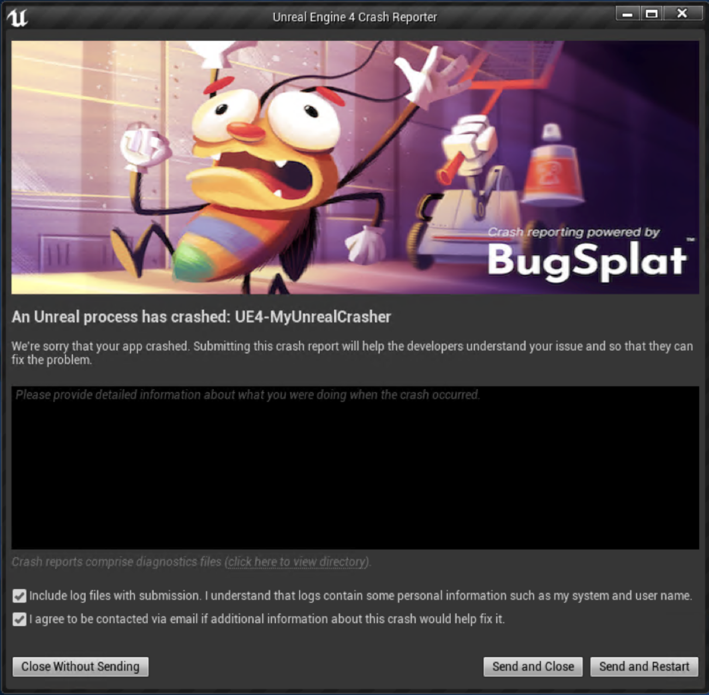
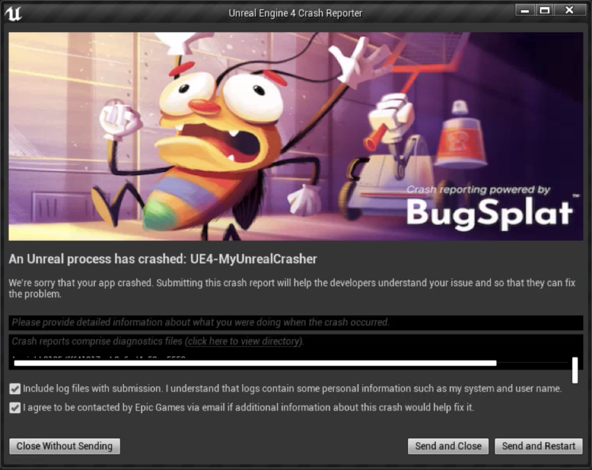

# Customizing the Crash Report Client


This guide was written for Unreal Engine 4. File names, line numbers, and build steps may differ in Unreal Engine 5.


## Overview

Crash Report Client is an Unreal Engine tool that allows developers to capture C++ crash reports from supported platforms. At crash time, a dialog is shown to the user so that they may add comments or replication steps to the details of the report. Once the crash report is submitted, it’s pushed to one of Epic’s servers so that developers can review the crash and fix the underlying issue.

Often, the crash is a result of code that wasn’t written by Epic. Crashes frequently occur in game code and not in the code of the underlying engine. By default, crashes in game code are not sent to the game developer which results in a lack of visibility into their program’s stability.

The Crash Report Client can be easily modified to send the code to a server controlled by the game programmers. Unfortunately, configuring the Crash Report Client to post to another server is not sufficient as the dialog the user sees still indicates that the crash report will be sent to Epic Games. Seeing an Epic Games branded dialog as opposed to a dialog branded by the game the user is playing is awkward and makes the user less likely to submit the crash report. Branding the Crash Report Client improves the user experience at one of the most frustrating points of gameplay.

Unreal Engine is open source and is open for modification. This allows for experienced developers to customize aspects of the engine to better support their game. Less experienced developers are less likely to customize the Crash Report Client dialog because of a lack of informational material in the forums and documentation. This guide attempts to provide developers with the resources they need to customize the Crash Report Client dialog and improve the user experience during their game’s most frustrating moments.

## Prerequisites

Customizing the Crash Report Client requires minimal changes to the Unreal Engine source code. Unreal Engine’s codebase seems intimidatingly large at first glance and the most difficult part about customizing the engine is deciding where to make changes. The following guide will walk you through obtaining, building, and customizing the Unreal Engine source code in order to customize the Crash Report Client dialog.

After completing this tutorial your Crash Report Client dialog should look like this:

<figure><figcaption></figcaption></figure>

Before customizing Unreal Engine you will need to obtain a copy of the engine’s source code. To download a copy of the UE4 source code a GitHub account must be connected with your Epic Game’s account [^1]. For more information about connecting your GitHub account to your Epic Games account please see this [doc](https://www.unrealengine.com/en-US/ue4-on-github). After your Epic Games and GitHub accounts have been connected you’ll be invited to the Epic Games organization on GitHub where you’ll have access to the EpicGames/UnrealEngine repository. Clone the Unreal Engine repo using git so that modifications can be made on your local system.

After the Unreal Engine source has been downloaded follow the steps in the [Getting Up and Running](https://github.com/EpicGames/UnrealEngine#getting-up-and-running) section of the repository’s README.md file to install dependencies and prepare your system for building the engine. Once you’ve finished the steps in the Getting Up and Running section make sure you can start the editor from within your debugger (Visual Studio on Windows, Xcode on macOS, etc).

## Customizing the Engine

This guide focuses on the `CrashReportClient` and `CrashReportClientEditor` projects within the UE4 solution. Once you’ve installed the prerequisites and built the UE4 solution you will only need to build the CrashReportClient and CrashReportClientEditor projects for your changes to take effect within the editor and packaged builds. Building the entirety of Unreal Engine can take several hours so building only the CrashReportClient and CrashReportClientEditor projects will save you significant amounts of time. Within the CrashReportClient project, there are a few particularly interesting files. This guide will focus on `CrashReportClientApp.cpp`, `CrashReportClientStyle.cpp` and `SCrashReportClient.cpp`.

The Crash Report Client dialog is built on top of Unreal Engine’s [Slate UI](https://docs.unrealengine.com/en-US/ProgrammingAndScripting/Slate/index.html) Framework and the dialog styles are defined in `CrashReportClientStyle.cpp`. To add an image to the dialog, we’ll need to create a new image brush and make an image available to the dialog at runtime. To provide an image to the dialog at run time, create a directory `UnrealEngine/Engine/Content/Slate/CrashReportClient`. In the directory you just created, paste a copy of a `Brand.png` file you plan to use for the dialog’s banner. This file should be approximately 600px in width and 260px in height.

Next, we’ll need to define a new image brush in the Crash Report Client dialog’s style set. Defining an image brush in the style set ensures that the asset is available to the Slate dialog at runtime. In `CrashReportClientStyle.cpp` add the following line of code (at the time of writing we added this to line [74](https://github.com/EpicGames/UnrealEngine/blob/77a65e872de6fb0ac4191d97562bac6581ffc8f8/Engine/Source/Programs/CrashReportClient/Private/CrashReportClientStyle.cpp#L74)):

```cpp
Style.Set("Brand", new IMAGE_BRUSH("CrashReportClient/Brand", FVector2D(600, 264)));
```

The line of code above defines a new Image Brush located in the `Slate/CrashReportClient` directory with the file name `Brand.png` and a requested size of width 600px and height 264px. The Image Brush asset can now be referenced in the style set by using the key `Brand`. In our experience you must add an entry into the style set instead of declaring the asset in the dialog directly, otherwise, the image will not load at runtime.

After we’ve defined our Brand image we need to add it to the Slate dialog. Adding an image to the dialog can be achieved by modifying the dialog’s Slate definition in `SCrashReportClient.cpp`. To display an image add the following code snippet (at the time of writing we added this to line [78](https://github.com/EpicGames/UnrealEngine/blob/77a65e872de6fb0ac4191d97562bac6581ffc8f8/Engine/Source/Programs/CrashReportClient/Private/SCrashReportClient.cpp#L78) just under the comment “// Stuff anchored to the top”):

```cpp
+SVerticalBox::Slot()
.AutoHeight()
.Padding(FMargin(4, 10))
[
    SNew(SImage)
    .Image(FCrashReportClientStyle::Get().GetBrush("Brand"))
]
```

The code above defines a new vertical box `Slot` in the parent `SVerticalBox` with an automatically determined height and a small amount of padding. Inside this slot, a new Slate element of type `SImage` was defined and constructed by passing the reference to the Brand Image Brush to `SNew`’s Image factory function.

At this point, you can test the changes you’ve made to the UE4 Crash Report Client dialog. If you’ve already launched the editor from Visual Studio all you need to do to test the Crash Report Client changes is right-click the `CrashReportClient` project and select build ensuring the `Development_Editor` configuration is still selected. After the build finishes run the UE4 project using the `Development_Editor` configuration from within Visual Studio to load the Select or Create New Project dialog.

To test the changes to the dialog, we’ve provided a sample project that will crash a few seconds after it’s started. You can find our sample project [here](https://github.com/BugSplat-Git/my-unreal-crasher). Clone the sample project and open it from the Select or Create New Project dialog. If the `Floating Actor` does not appear, follow the directions in our sample project. Once you’ve gotten the floating actor to appear, click the Play button to start the game. If everything is working correctly you should see the Crash Report Client dialog after a few seconds. If you get an error that the engine modules are out of date, open the .sln file for your UE4 project and build/run from there instead.

<figure><figcaption></figcaption></figure>

Notice that the dialog is sized incorrectly - the extra size the Brand image takes up squishes the text boxes. We can improve the design of the Crash Report Client dialog by increasing its height. To increase the height of the dialog modify the following line in `CrashReportClientApp.cpp`:

```cpp
/** Default main window size */
const FVector2D InitialWindowDimensions(740, 560);
```

The next step is to change the wording in the dialog. For studios that develop games using C++, it makes sense to send the crash reports to BugSplat instead of Epic’s servers so that developers can identify and diagnose their most critical issues. Replacing the Epic-specific text in the dialog with something related to your company or studio is more likely to yield high-quality crash submissions from your users. To remove Epic specific text from the dialog modify the following lines in `SCrashReportClient.cpp`:

```cpp
FText CrashDetailedMessage = LOCTEXT("CrashDetailed", "We are very sorry that this crash occurred. Our goal is to prevent crashes like this from occurring in the future. Please help us track down and fix this crash by providing detailed information about what you were doing so that we may reproduce the crash and fix it quickly. You can also log a Bug Report with us using the <a id=\"browser\" href=\"https://epicsupport.force.com/unrealengine/s/\" style=\"Hyperlink\">Bug Submission Form</> and work directly with support staff to report this issue.\n\nThanks for your help in improving the Unreal Engine.");
```

```cpp
SNew(STextBlock)
    .AutoWrapText(true)
    .IsEnabled(!FEngineBuildSettings::IsInternalBuild())
    .Text(LOCTEXT("IAgree", "I agree to be contacted by Epic Games via email if additional information about this crash would help fix it."))
```

Finally, it doesn’t make much sense to display a non-symbolicated stack trace to users after the game is launched. For most players seeing an unsymbolicated stack trace is likely to confuse them and increase friction between them and sending a crash report. Let’s take out that dialog by replacing the following lines in `SCrashReportClient.cpp` (at the time of writing we removed lines [144](https://github.com/EpicGames/UnrealEngine/blob/77a65e872de6fb0ac4191d97562bac6581ffc8f8/Engine/Source/Programs/CrashReportClient/Private/SCrashReportClient.cpp#L144) to [201](https://github.com/EpicGames/UnrealEngine/blob/77a65e872de6fb0ac4191d97562bac6581ffc8f8/Engine/Source/Programs/CrashReportClient/Private/SCrashReportClient.cpp#L201)):

```diff
-+SSplitter::Slot()
-.Value(0.7f)
-[
-	SNew(SVerticalBox)
-
-	+SVerticalBox::Slot()
-	.AutoHeight()
-	[
-		SNew(SOverlay)
-
-		+SOverlay::Slot()			
-		[
-			SNew(SColorBlock)
-			.Color(FLinearColor::Black)
-		]
-
-		+SOverlay::Slot()
-		[
-
-			SNew(SRichTextBlock)
-			.Margin(FMargin(4, 2, 0, 8))
-			.TextStyle(&FCrashReportClientStyle::Get().GetWidgetStyle<FTextBlockStyle>("CrashReportDataStyle" ) )
-			.Text(CrashReportDataText)
-			.AutoWrapText(true)
-			.DecoratorStyleSet(&FCrashReportClientStyle::Get())
-				
-			+SRichTextBlock::HyperlinkDecorator(TEXT("browser"), FSlateHyperlinkRun::FOnClick::CreateStatic(&OnViewCrashDirectory))
-		]
-	]
-
-	+SVerticalBox::Slot()
-	.FillHeight(0.7f)
-	[
-		SNew(SOverlay)
-		
-		+SOverlay::Slot()
-		[
-			SNew(SMultiLineEditableTextBox)
-			.Style(&FCrashReportClientStyle::Get().GetWidgetStyle<FEditableTextBoxStyle>("NormalEditableTextBox"))
-			.Font(FCoreStyle::GetDefaultFontStyle("Regular", 8))
-			.AutoWrapText(false)
-			.IsReadOnly(true)
-			.ReadOnlyForegroundColor(FSlateColor(FLinearColor::White * 0.8f))
-			.BackgroundColor(FSlateColor(FLinearColor::Black))
-			.ForegroundColor(FSlateColor(FLinearColor::White * 0.8f))
-			.Text(Client, &FCrashReportClient::GetDiagnosticText)
-		]
-
-		+SOverlay::Slot()
-		.HAlign(HAlign_Center)
-		.VAlign(VAlign_Center)
-		[
-			SNew(SThrobber)
-			.Visibility(CrashReportClient.ToSharedRef(), &FCrashReportClient::IsThrobberVisible)
-			.NumPieces(5)
-		]
-	]
-]
++SVerticalBox::Slot()
+.AutoHeight()
+[
+	SNew(SRichTextBlock)
+	.Margin(FMargin(4, 2, 0, 8))
+	.TextStyle(&FCrashReportClientStyle::Get().GetWidgetStyle<FTextBlockStyle>("CrashReportDataStyle"))
+	.Text(CrashReportDataText)
+	.AutoWrapText(true)
+	.DecoratorStyleSet(&FCrashReportClientStyle::Get())
+
+	+SRichTextBlock::HyperlinkDecorator(TEXT("browser"), FSlateHyperlinkRun::FOnClick::CreateStatic(&OnViewCrashDirectory))
+]
```

We don’t want users seeing stack traces after release, however, during pre-release testing showing a stack trace makes much more sense, especially when Unreal Engine can locate symbols and symbolicate the stack trace in the dialog (this is the case for crashes that happen in the editor). Let’s use compiler conditionals to create two versions of the Crash Report Client dialog in `SCrashReportClient.cpp`:

```cpp
#if UE_BUILD_SHIPPING
    // ChildSlot code with the branding image goes here
#else
    // Original UE4 ChildSlot code without the branding image goes here
#endif
```

That’s it! You’ve just learned how to customize the Crash Report Client and improved the user experience when it matters most. Happy splattin’!

## Distribution

If you want to allow people to work on your game without having to build your version of the engine, you can build a redistributable version by following these steps. A straightforward way to package the Unreal Engine is by using the Unreal Automation Tool to create a custom engine ‘drop’ [^2]. Several Unreal Engine drops can live side by side on a system so that developers can use the drop that best suits the needs of their game.

The following steps can be used to create an Unreal Engine drop on Windows:

1. Clone the Unreal Engine source code

   ```batch
   git clone https://github.com/EpicGames/UnrealEngine
   ```
2. Run `Setup.bat`
3. Run `GenerateProjectFiles.bat`
4. Open `UE4.sln` with Visual Studio 2017 or Visual Studio 2019
5. Make the code changes specified in the [Customizing the Engine](#customizing-the-engine) section of this document
6. Verify you can build and run UE4 and that it contains all the changes that you made in the previous step
7. In the UnrealEngine (root) directory run the Unreal Automation Tool to build a version of your customized engine for Win64 (this step requires Visual Studio 2017, the build will fail if you only have Visual Studio 2019 installed on your system):

   ```batch
   Engine\Build\BatchFiles\RunUAT.bat BuildGraph -target="Make Installed Build Win64" -script=Engine/Build/InstalledEngineBuild.xml -clean -set:WithWin64=true -set:WithLinux=false -set:WithServer=false -set:HostPlatformDDCOnly=false -set:WithWin32=false -set:WithMac=false -set:WithAndroid=false -set:WithIOS=false -set:WithTVOS=false -set:WithLinuxAArch64=false -set:WithLumin=false -set:WithLuminMac=false -set:WithHoloLens=false
   ```
8. The result will be saved in `UnrealEngine\LocalBuilds`. Run the following to copy some additional files into your engine drop:

   ```batch
   copy Setup.bat LocalBuilds\Engine\Windows
   copy Engine\Binaries\Win64\UnrealVersionSelector-Win64-Shipping.exe LocalBuilds\Engine\Windows\Binaries\Win64
   copy Engine\Binaries\DotNET\GitDependencies.exe LocalBuilds\Engine\Windows\Binaries\DotNET
   copy Engine\Binaries\DotNET\GitDependencies.exe.config LocalBuilds\Engine\Windows\Binaries\DotNET
   ```
9. In your `LocalBuilds` directory run `Setup.bat`
10. You can now run `UnrealEditor.exe` from `LocalBuilds\Engine\Windows\Binaries` to create games with your customized engine!
11. To open projects with your customized engine you’ll need to edit the .uproject file and change the EngineAssociation field. You can find the value to put here by opening regedit and navigating to `HKEY_CURRENT_USER\Software\Epic Games\Unreal Engine\Builds`. Use the name value of the key that corresponds to the path to your `LocalBuilds` folder

Please send any comments or questions to [support@bugsplat.com](mailto:support@bugsplat.com).

## References

[^1]: [Downloading Unreal Engine Source Code](https://docs.unrealengine.com/en-US/ProgrammingAndScripting/ProgrammingWithCPP/DownloadingSourceCode/index.html)

[^2]: [Managing Multiple UE4 Projects](https://www.wisengineering.com/downloads/ManagingUE4Projects.pdf)
