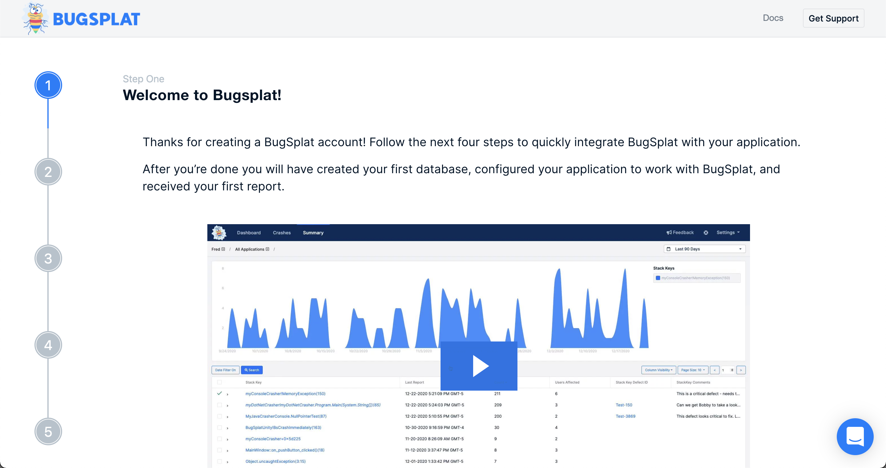

# Signing Up

To register an account with BugSplat, visit the [Sign Up](https://app.bugsplat.com/v2/sign-up) page and enter your first name, last name, company email (or another email you wish to be associated with your account), and a password. Passwords must be 14-64 characters and include an uppercase letter, a lowercase letter, a number, and a symbol. You'll be asked to re-enter your password to confirm it.

Once you've hit **Sign Up** you'll be a registered user of BugSplat.

Then, you'll be presented with a screen welcoming you to BugSplat. Here you can either use the Onboarding Tool, which helps you quickly configure new accounts, or skip it and go directly to the [Dashboard](../development/using-the-app.md#dashboard) page.


🤝 **Looking to join an existing team?** See our [Requesting Access](../../administration/user-management/requesting-access-to-your-teams-accounts.md) page.

