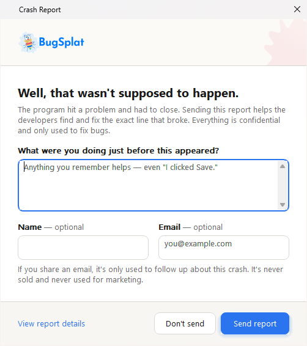

# BugSplat for Windows (C++)


Need help upgrading from an older version of BugSplat? Check out our [upgrade guide](bugsplat-for-windows-upgrade-guide.md) to get started.


### Overview 👀

This document explains how to modify your Microsoft Visual C++ application to provide full debug information to the BugSplat web application when it crashes.

### Getting Started 🚦&#x20;

To begin, download and unzip the BugSplat SDK for Microsoft Visual C++ from `https://app.bugsplat.com/download/bugsplat-windows.zip`. The download doesn't need a login, so a build script or a coding agent can fetch it too:

```powershell
Invoke-WebRequest -Uri "https://app.bugsplat.com/download/bugsplat-windows.zip" -OutFile BugSplat.zip
Expand-Archive BugSplat.zip -DestinationPath "$env:TEMP\BugSplatSdk"
Copy-Item -Recurse "$env:TEMP\BugSplatSdk\BugSplat" third_party\BugSplat
```

The URL returns the latest release. Releases after 9.2.0 can also be pinned: add `?version=` and the release's version number.

In a Visual Studio project, you can install the `BugSplat` NuGet package instead of downloading the zip. See [NuGet](#nuget).


Setting BugSplat up with a coding agent? [For AI Coding Agents](../../../introduction/getting-started/for-ai-coding-agents.md) lists what the agent needs from you and how it can confirm a test crash arrived.


The SDK is organized per platform (`win32`, `x64`, `ARM64`) and configuration (`Release`, `Debug`):

| Folder | Contents |
| --- | --- |
| `BugSplat\inc` | `BugSplat.h` (C++ API), `BugSplatC.h` (C API) and `BugSplatVersion.h` (the SDK's version) |
| `BugSplat\<platform>\<config>\bin` | Runtime files that ship next to your executable: `BugSplat.dll`, `BugSplatMonitor.exe`, `BugSplatReporter.exe`, and `BugSplatWer.dll`, plus an optional `BugSplatTheme` folder |
| `BugSplat\<platform>\<config>\lib\md` | Static `BugSplat.lib` built with `/MD` (dynamic CRT) |
| `BugSplat\<platform>\<config>\lib\mt` | Static `BugSplat.lib` built with `/MT` (static CRT) |
| `BugSplat\<platform>\<config>\lib\dll` | Import library for `BugSplat.dll` |

Link exactly one `BugSplat.lib` from the `lib` subfolder that matches your link model and runtime library setting, and ship the contents of `bin` with your application (`BugSplat.dll` is only needed if you link the import library).

`BugSplatVersion.h`, added in 9.3.0, defines `BUGSPLAT_VERSION` (for example `"9.3.0"`) and `BUGSPLAT_VERSION_MAJOR`, `BUGSPLAT_VERSION_MINOR` and `BUGSPLAT_VERSION_PATCH`, so you can tell which release a project was built against. `BugSplat.h` and `BugSplatC.h` include it.

The `BugSplatTheme` folder holds `theme.json` and `strings.en-US.json`, which `BugSplatReporter.exe` reads at runtime to decide how the crash dialog looks and what it says. It is optional — the reporter has a built-in copy of both — but ship it if you want to rebrand or reword the dialog. See [Crash Dialog Branding](../../../education/how-tos/customize-the-crash-dialog.md).


Curious how these four files fit together, or debugging a report that arrived without a dialog? See [How the Windows Crash Reporter Works](how-the-windows-crash-reporter-works.md).


To get a feel for the BugSplat service before enabling your application, feel free to experiment with the [MyConsoleCrasher sample application](../../../introduction/getting-started/posting-a-test-crash/myconsolecrasher-c-plus-plus/), which is included as part of the software development kit and is also available on [GitHub](https://github.com/BugSplat-Git/Samples/tree/main/Samples/MyConsoleCrasher). For a native desktop application example, see the [MyCrasher sample](https://github.com/BugSplat-Git/Samples/tree/main/Samples/MyCrasher), an ATL/MFC Windows app.

### Integration 🏗️


For WinUI 3 applications, BugSplat must be registered as a WER [RuntimeExceptionModule](https://learn.microsoft.com/en-us/windows/win32/api/werapi/nf-werapi-werregisterruntimeexceptionmodule). This process is demonstrated in the MyWinUI3Crasher sample, which is available in the SDK and on [GitHub](https://github.com/BugSplat-Git/Samples/tree/main/Samples/MyWinUI3Crasher).&#x20;


Add BugSplat to your application using the following steps:

1. Link with **`BugSplat.lib`**  by adding an entry to `Linker > Input > Additional Dependencies`, and add the matching folder to `Linker > General > Additional Library Directories`: `lib\md` if your application builds with `/MD` (the Visual Studio default), or `lib\mt` if it builds with `/MT`.
2. Add **`BugSplatMonitor.exe`**, **`BugSplatReporter.exe`**, and **`BugSplatWer.dll`** (from the SDK's `bin` folder) to your application's installer, along with the `BugSplatTheme` folder if you're customizing the dialog.
3. Ensure your installer runs with Administrator privileges and creates a `RuntimeExceptionHelperModules` registry key with a name containing the full path to `BugSplatWer.dll`. For more information about configuring WER see this [doc](bugsplat-for-windows-upgrade-guide.md#registry-changes). If your application's manifest sets `uiAccess="true"`, this step is required: every crash and hang is captured through WER (see [Apps with uiAccess](how-the-windows-crash-reporter-works.md#apps-with-uiaccess)).

<figure><figcaption></figcaption></figure>


BugSplat's runtime files (`BugSplatMonitor.exe`, `BugSplatReporter.exe`, `BugSplatWer.dll`, and `BugSplat.dll` if you use the dynamic library) depend on the **Visual C++ 2015–2022 runtime**: `MSVCP140.dll`, `VCRUNTIME140.dll`, and `VCRUNTIME140_1.dll` on x64. These DLLs are **not part of Windows** and are missing on machines where no application has installed the redistributable. If they're absent, your application will run normally but crash reporting will fail. End users may see a "MSVCP140.dll was not found" error at crash time.

This applies even if your own application doesn't need the Visual C++ runtime (for example, if it's built with `/MT`). Make sure your installer either:

* chains the [Visual C++ Redistributable](https://learn.microsoft.com/en-us/cpp/windows/latest-supported-vc-redist) installer that **matches the architecture of the BugSplat files you ship** (`vc_redist.x64.exe`, `vc_redist.x86.exe`, or `vc_redist.arm64.exe`), or
* copies `msvcp140.dll` and `vcruntime140.dll` (plus `vcruntime140_1.dll` on x64) from the redistributable into your application folder alongside the BugSplat runtime files.


4. Include **`BugSplat.h`** in your application's source.
5. Create an instance of `BugSplat` following the example in [MyConsoleCrasher](../../../introduction/getting-started/posting-a-test-crash/myconsolecrasher-c-plus-plus/). The BugSplat constructor requires three parameters: `database`, `application`, and `version`. A new BugSplat database can be created on the [Database](https://app.bugsplat.com/v2/database) page. Choose values for application name and version to match your product release. These same values are typically used when uploading symbol files for your application. Learn more about symbol uploads at [symbol-upload](../../../introduction/development/working-with-symbol-files/upload-symbols-with-symbol-upload.md).

```cpp
#include "BugSplat.h"

BugSplat g_BugSplat(BUGSPLAT_DATABASE, APPLICATION_NAME, APPLICATION_VERSION);
```

6. Modify your build settings so that symbol files are created for release builds. Set `C/C++ > General > Debug Information Format` to `Program Database /Zi`. Be sure to also set `Linker > Debugging > Generate Debug Info` to `Yes (/DEBUG)`.
7. Configure a Post-Build step to upload your application's [symbol files](../../../introduction/development/working-with-symbol-files/). Your script should authenticate using OAuth Client Credentials. You can create credentials on the [Integrations](https://app.bugsplat.com/v2/database/integrations#oauth) page under the OAuth tab. Set them as `SYMBOL_UPLOAD_CLIENT_ID` and `SYMBOL_UPLOAD_CLIENT_SECRET` in the build environment so the secret stays out of your project file.

```batch
symbol-upload-windows.exe -b your-database -a your-app -v your-version -d "$(OutDir)\" -f "*.{pdb,exe,dll}"
```

`-f` defaults to `*.js.map`, so leave it out and nothing from a C++ build is uploaded.


To get complete symbolicated call stacks and variable names for each crash, you should upload all **`.exe`**, **`.dll`**, and **`.pdb`** files for your product every time you build a release version of your application for distribution or internal testing.


### CMake 🧱

With CMake and the MSVC compiler, link the static library and copy the runtime files next to your executable after each build. This example assumes the SDK's `BugSplat` folder is at `third_party/BugSplat`, that your target is `MyApp`, and that it uses CMake's default runtime library, `/MD` (or `/MDd` in Debug):

```cmake
set(BUGSPLAT_DIR "${CMAKE_CURRENT_SOURCE_DIR}/third_party/BugSplat")

if(CMAKE_CXX_COMPILER_ARCHITECTURE_ID STREQUAL "X86")
  set(BUGSPLAT_PLATFORM Win32)
else()
  set(BUGSPLAT_PLATFORM ${CMAKE_CXX_COMPILER_ARCHITECTURE_ID})
endif()
set(BUGSPLAT_CONFIG_DIR "${BUGSPLAT_DIR}/${BUGSPLAT_PLATFORM}/$<IF:$<CONFIG:Debug>,Debug,Release>")

target_include_directories(MyApp PRIVATE "${BUGSPLAT_DIR}/inc")
target_link_libraries(MyApp PRIVATE "${BUGSPLAT_CONFIG_DIR}/lib/md/BugSplat.lib")

add_custom_command(TARGET MyApp POST_BUILD
  COMMAND ${CMAKE_COMMAND} -E copy_directory "${BUGSPLAT_CONFIG_DIR}/bin" "$<TARGET_FILE_DIR:MyApp>")
```

`CMAKE_CXX_COMPILER_ARCHITECTURE_ID` is `x64`, `ARM64` or `X86` for MSVC, which matches the SDK's folder names except for `Win32`. If your target sets `MSVC_RUNTIME_LIBRARY` to a static runtime (`/MT`), link `lib/mt/BugSplat.lib` instead. Install the same files from `bin` with your application, as in step 2.

To produce `.pdb` files for Release builds, use the `RelWithDebInfo` configuration, or add `/Zi` to the compiler flags and `/DEBUG` to the linker flags for Release.

### Dynamic Library 🔗

The SDK also ships as a dynamic library, **`BugSplat.dll`**, with a flat C API declared in **`BugSplatC.h`**. The DLL exposes the same crash reporting engine as `BugSplat.lib` through `BugSplat_*` functions. Choose the dynamic library when:

* You don't want your runtime library setting (`/MT` vs `/MD`) coupled to BugSplat's. Only the C ABI crosses the DLL boundary, so your application's CRT choice doesn't need to match the SDK's.
* You're calling BugSplat from another language (C#, Rust, Python, etc.) via P/Invoke or FFI.

To integrate the dynamic library, follow the steps above with these differences:

1. Link with the import library **`lib\dll\BugSplat.lib`** instead of a static `BugSplat.lib`, and include **`BugSplatC.h`** instead of `BugSplat.h`.
2. Ship **`BugSplat.dll`** alongside your executable, in addition to `BugSplatMonitor.exe`, `BugSplatReporter.exe`, and `BugSplatWer.dll`.
3. Initialize BugSplat with the C API:

```cpp
#include "BugSplatC.h"

BugSplat_Init(BUGSPLAT_DATABASE, APPLICATION_NAME, APPLICATION_VERSION);
BugSplat_SetUser(L"fred");
BugSplat_SetAttribute(L"branch", L"main");
```


The C API is also available to static library consumers: define `BUGSPLAT_STATIC` before including `BugSplatC.h`. See the [API documentation](bugsplat-for-windows-api-documentation.md#c-api-bugsplatc.h) for the full list of `BugSplat_*` functions.


### NuGet 📦

From 9.3.0, the [BugSplat](https://www.nuget.org/packages/BugSplat) NuGet package also works in C and C++ projects (`.vcxproj`), and sets up the dynamic library for you. Install it from Visual Studio's NuGet package manager, or run this in the Package Manager Console:

```powershell
Install-Package BugSplat
```

The package:

* adds `BugSplatC.h` and `BugSplatVersion.h` to the include path
* links `BugSplat.dll`'s import library for the project's platform: `Win32`, `x64` or `ARM64`
* in an Application project, copies `BugSplat.dll`, `BugSplatMonitor.exe`, `BugSplatReporter.exe`, `BugSplatWer.dll` and their `.pdb` files to the output folder after each build, with the `BugSplatTheme` folder if there's one next to the `.vcxproj`

Initialize BugSplat with the C API, as in step 3 above. The package doesn't contain the static library, so the C++ `BugSplat` class needs the SDK download.

In a DLL or static library project, the package adds the header and the import library but copies nothing. To copy the runtime files there too, set `BugSplatCopyNativeFiles` to `true` in the project.

Your installer still has to ship the runtime files, register `BugSplatWer.dll` and provide the Visual C++ runtime, as in steps 2 and 3 of [Integration](#integration).

### Verification ✅

Test your application by forcing a crash.

```cpp
*(volatile int *)0 = 0;
```

Verify that the BugSplat dialog appears, and that crashes are posted to your BugSplat account. Ensure that symbol names in the call stack are resolved correctly. If they aren’t, double-check that the correct version of symbol files and all executables for your application have been uploaded to BugSplat.

If everything was configured correctly, you should see a crash report that looks like this in your BugSplat database.

<figure><figcaption><p>BugSplat Crash Page</p></figcaption></figure>

#### Crash Dialog

The dialog is shown by `BugSplatReporter.exe`, which `BugSplatMonitor.exe` launches once the crash has been captured. It follows the end user's Windows light or dark mode:

<figure><figcaption><p>BugSplat Crash Dialog</p></figcaption></figure>

It reads its colors, type, layout and copy from the `BugSplatTheme` folder at run time, so customizing it means editing JSON rather than rebuilding anything. Its text can also link to your privacy policy or support site, for domains you allow with `SetCrashDialogLinkDomains`. See [Crash Dialog Branding](../../../education/how-tos/customize-the-crash-dialog.md), and [How the Windows Crash Reporter Works](how-the-windows-crash-reporter-works.md) for the process split. To upload reports without showing the dialog, call `SetQuietMode(true)`.


If crash reports arrive but no dialog ever appears, `BugSplatReporter.exe` is almost certainly missing from your install folder. The monitor uploads the report without the dialog in that case and logs the reason to `BugSplat.log`.


### When Crashes Don't Arrive 🔍

None of these problems shows an error in your application. Check them in this order:

* **A debugger is attached.** The debugger handles the exception before BugSplat does. Run the application without debugging (Ctrl+F5 in Visual Studio) when you test.
* **The runtime files aren't next to the executable.** `BugSplatMonitor.exe` has to be in the same folder as your application, along with `BugSplatReporter.exe` and `BugSplatWer.dll`.
* **The Visual C++ runtime is missing** on the machine that crashed. See the warning under step 3.
* **The upload failed.** The monitor keeps the report in `%TEMP%\BugSplat\<appName>-<appVersion>\<guid>\` and tries again the next time your application starts, up to three times. `BugSplat.log` in that folder says why the upload failed.
* **Only some crashes arrive.** Stack buffer overruns, heap corruption and other fail-fast crashes skip the unhandled exception filter, so BugSplat reports them only when `BugSplatWer.dll` is registered. `IsWerEnabled()` (`BugSplat_IsWerEnabled()` in C) returns `false` until it is; see [Registry Changes](bugsplat-for-windows-upgrade-guide.md#registry-changes).
* **No crashes arrive from an app with `uiAccess="true"`.** The monitor runs below the app's integrity level and can't write its dumps, so they're captured through WER, which needs `BugSplatWer.dll` registered. `BugSplat.log` says `BugSplat monitor runs at integrity level 0x2000, below this application's 0x3000` when this applies. Reports you send yourself with `GenerateDump` and `PostCrash` aren't captured in such an app; see [Apps with uiAccess](how-the-windows-crash-reporter-works.md#apps-with-uiaccess).
* **Call stacks show addresses, such as `MyApp+0x12b5`.** The symbols for that application name and version weren't uploaded, or came from a different build. Re-run the upload from step 7 for the build that crashed.

## User Feedback

In addition to crash reporting, BugSplat supports collecting non-crashing user feedback such as bug reports and feature requests. Feedback reports appear in BugSplat with the "User Feedback" type, grouped by title.

Set user details and an application key, then call `PostFeedback` on your `BugSplat` instance:

```cpp
g_BugSplat.SetUser(L"Jane");
g_BugSplat.SetEmail(L"jane@example.com");
g_BugSplat.SetKey(L"en-US");

bool success = g_BugSplat.PostFeedback(L"Login button broken", L"Nothing happens when I tap it");
```

To include file attachments such as screenshots or log files:

```cpp
std::vector<const wchar_t*> attachments = {
    L"C:\\path\\to\\screenshot.png",
    L"C:\\path\\to\\log.txt"
};
bool success = g_BugSplat.PostFeedback(L"Login button broken", L"Nothing happens when I tap it", attachments);
```

You can also add attachments individually with `AddAttachment()` before calling `PostFeedback()`. All attachments passed to `PostFeedback` are cleared after each feedback upload whereas attachments added via `AddAttachment()` are added the current report and future reports during the current session.

## Dependencies

See technology dependencies on our [dependencies page](dependencies.md).
